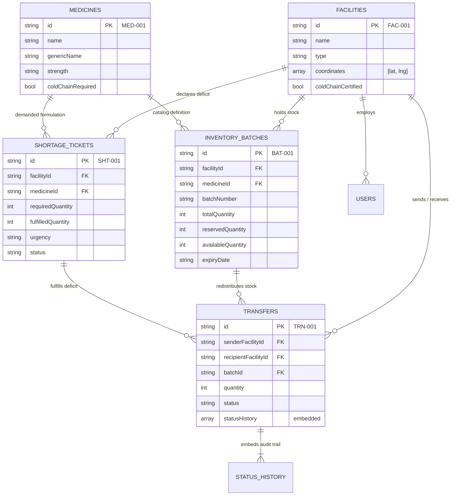

# PharmaSync CARE — MongoDB Collection Relationships & Validation

> **System:** PharmaSync CARE — Intelligent Medicine Redistribution Network  
> **Database:** MongoDB Atlas  
> **Documentation:** Collection Relationships, Aggregate Boundaries, and Application Invariants

---

## 1. Collection Relationship Architecture

While MongoDB Atlas is a non-relational document database without native foreign key constraints, PharmaSync CARE maintains strict logical relationships between its collections through standardized identifiers (`FAC-XXX`, `MED-XXX`, `BAT-XXX`, `SHT-XXX`, `TRN-XXX`) and application-level integrity validation in the Flask service layer.



---

## 2. Document Boundaries: Embedding vs. Referencing

| Relationship | Modeling Strategy | Justification |
| :--- | :--- | :--- |
| **Transfer &rarr; Status Transitions** | **Embedded Array** (`statusHistory`) | Audit entries are always read and written together with the transfer manifest. Embedding eliminates multi-document lock overhead and ensures atomic audit recording. |
| **Facility &rarr; GPS Coordinates** | **Embedded Array** (`coordinates: [lat, lng]`) | Coordinates are an immutable attribute of a physical facility node and are queried simultaneously with facility metadata. |
| **Medicine &rarr; Storage Specs** | **Embedded Fields** (`storageTempMin`, `storageTempMax`) | Formulation temperature specifications have no independent lifecycle outside the medicine monograph. |
| **Facility &rarr; Inventory Batches** | **Referenced Collection** (`inventory_batches.facilityId`) | High write frequency (daily stock updates, reservation increments, transfers). An embedded array inside a facility document would risk unbounded document growth and write contention. |
| **Facility &rarr; Shortages** | **Referenced Collection** (`shortage_tickets.facilityId`) | Independent lifecycles and query patterns (shortages are frequently triaged across the entire regional network). |
| **Batch &rarr; Transfers** | **Referenced Collection** (`transfers.batchId`) | Multiple transfers may draw stock from a single batch over time. |

---

## 3. Application-Level Integrity Invariants (Flask Enforcement)

Because MongoDB Atlas does not automatically reject invalid references or enforce `CHECK` constraints, the Python Flask backend implements strict pre-write assertions:

### 3.1 Facility & Medicine Existence
- **Rule:** When creating an inventory batch or shortage ticket, `facilityId` must resolve to an existing document in `facilities`, and `medicineId` must resolve to an existing document in `medicines`.
- **Enforcement:** `InventoryService.add_batch` and `ShortageService.create_shortage` invoke `FacilityRepository.get_by_id()` and `MedicineRepository.get_by_id()`. If either returns `None`, an HTTP `422 Unprocessable Entity` is returned with an explicit validation error code.

### 3.2 Inventory Quantity & Reservation Invariants
- **Rule:** `totalQuantity = availableQuantity + reservedQuantity`. Available quantity cannot drop below zero (`availableQuantity >= 0`).
- **Enforcement:**
  - On batch creation: `availableQuantity` is calculated as `totalQuantity - reservedQuantity`.
  - On transfer creation: Stock reservation is performed using atomic MongoDB conditional operators:
    ```python
    db.inventory_batches.update_one(
        {"id": batch_id, "availableQuantity": {"$gte": transfer_quantity}},
        {"$inc": {"reservedQuantity": transfer_quantity, "availableQuantity": -transfer_quantity}}
    )
    ```
    If `matched_count == 0`, the operation fails atomically with `422 INSUFFICIENT_STOCK`.

### 3.3 Cold Chain Compatibility Verification
- **Rule:** A medicine requiring continuous cold-chain storage (`coldChainRequired: true`) can only be transferred between facilities that are cold-chain certified (`coldChainCertified: true`).
- **Enforcement:** `MatchingService.find_candidates` and `TransferService.create_transfer` verify the cold-chain certifications of both the donor and recipient facilities before confirming transfer feasibility.

### 3.4 Shelf-Life Safety Buffer
- **Rule:** Batches with $< 15$ days of remaining shelf life cannot be transferred. Batches transferred to clinics must satisfy the recipient's minimum safety buffer (default: 45 days).
- **Enforcement:** Verified in `MatchingService` and `TransferService` before manifest creation.

### 3.5 Simulation & Optimization Isolation
- **Rule:** Discrete-event simulation runs in `simulation_runs` and multi-objective optimization experiments in `optimization_runs` must NEVER modify active records in `inventory_batches`, `transfers`, or `shortage_tickets`.
- **Enforcement:** Simulation routes read current snapshots but persist results exclusively into their dedicated collections.
