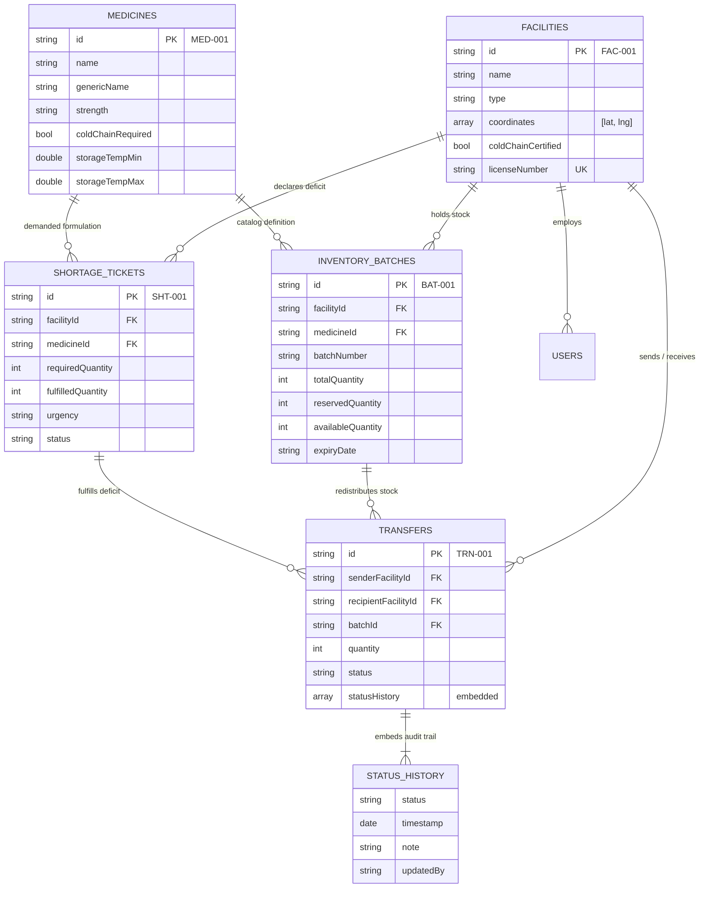
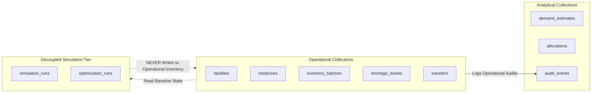

# PharmaSync CARE — MongoDB Collection Relationship Diagram

> **System:** PharmaSync CARE — Intelligent Medicine Redistribution Network  
> **Architecture:** Non-relational Document Model on MongoDB Atlas  
> **Schema Version:** 3.0.0  
> **Reference Specifications:** [`docs/MONGODB_SCHEMA.md`](MONGODB_SCHEMA.md) & [`docs/COLLECTION_RELATIONSHIPS.md`](COLLECTION_RELATIONSHIPS.md)

---

## 1. Architectural Overview

PharmaSync CARE uses **MongoDB Atlas** organized into three decoupled architectural tiers. Strategic embedding is used for high-cohesion sub-documents (such as transfer status audit logs, contact information, and geographic coordinates), while cross-document relationships are modeled via stable synthetic identifiers (`FAC-XXX`, `MED-XXX`, `BAT-XXX`, `SHT-XXX`, `TRN-XXX`) and enforced in application business logic.

---

## 2. Decoupled Simulation & Optimization Tier

The analytical and simulation collections operate in complete sandbox isolation from the operational inventory collections:

