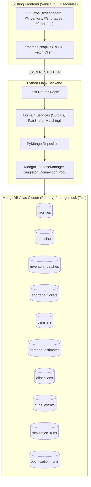

# PharmaSync CARE — MongoDB Atlas Migration Plan

## 1. Executive Summary & Architecture Transition

This document defines the engineering plan for migrating the **PharmaSync CARE** platform from MySQL 8.0 to **MongoDB Atlas**, preserving the existing vanilla JavaScript frontend, responsive layout, Chart.js visual charts, Leaflet geographic maps, and REST API contract ([`docs/API_CONTRACT.md`](API_CONTRACT.md)).



---

## 2. Pre-Migration Asset Inventory

1. **`docs/API_CONTRACT.md` (Version 2.4.0)**: Remains the authoritative REST specification for paths, query parameters, payloads, and unified response envelopes (`{status, success, data, meta}`).
2. **`sql/schema.sql` & `sql/seed.sql`**: Relational MySQL DDL and seed scripts. Retired in favor of `backend/scripts/init_db.py` and `backend/scripts/seed_data.py`.
3. **`docs/ER_DIAGRAM.md` & `docs/DATA_DICTIONARY.md`**: Transitioned to document collection schemas, BSON data types, embedded structures, and indexing definitions.
4. **`frontend/`**: Complete vanilla JavaScript Single-Page Application. No code modifications required as frontend communicates exclusively via HTTP REST with Flask backend.
5. **`backend/`**: Modular Flask structure (`routes/`, `services/`, `repositories/`, `utils/`). Migration modifies the repository layer to use PyMongo collections.

---

## 3. MongoDB Collection Design & Boundary Strategy

### 3.1 Document Boundaries & Embedding
- **`facilities`**: Primary healthcare nodes (`FAC-XXX`). Embeds coordinates `[lat, lng]` and contact details `{person, phone}`.
- **`medicines`**: Formulary monographs (`MED-XXX`). Embeds temperature bounds `{min, max}`.
- **`inventory_batches`**: Multi-batch physical stock (`BAT-XXX`). Denormalizes `facilityName` and `medicineName` to eliminate $O(N)$ join queries in inventory tables.
- **`shortage_tickets`**: Clinical stock deficit requests (`SHT-XXX`). Embeds urgency scoring and fulfillment metrics.
- **`transfers`**: Redistribution manifests (`TRN-XXX`). Embeds complete lifecycle audit history array (`statusHistory: [{status, timestamp, note, updatedBy}]`).
- **`simulation_runs` & `optimization_runs`**: Decoupled sandboxed records completely isolated from operational collections.

---

## 4. Concurrency Safety & Quantity Invariants

### 4.1 Stock Quantity Invariants
- `totalQuantity` = Physical on-hand stock.
- `reservedQuantity` = Stock allocated to pending/in-transit manifests.
- `availableQuantity` = `totalQuantity - reservedQuantity`. Invariant: `availableQuantity >= 0` always.

### 4.2 Atomic Conditional Updates
Stock reservation uses atomic document-level operations:
```python
result = db.inventory_batches.update_one(
    {"id": batch_id, "availableQuantity": {"$gte": requested_qty}},
    {
        "$inc": {
            "reservedQuantity": requested_qty,
            "availableQuantity": -requested_qty
        },
        "$set": {"updatedAt": datetime.now(timezone.utc)}
    }
)
```
This guarantees race-condition prevention under high concurrency without table-level locking.

---

## 5. Migration Roadmap

- **Milestone A**: Asset inspection and migration planning.
- **Milestone B**: PyMongo driver configuration, connection pooling, and timeout management.
- **Milestone C**: Verified health endpoint (`GET /api/health`) using live `db.command('ping')`.
- **Milestone D**: MongoDB initialization script (`init_db.py`) and repeatable synthetic seed script (`seed_data.py`).
- **Milestone E**: Migration of core repositories (`facilities`, `medicines`, `inventory`, `shortages`) with ObjectId validation.
- **Milestone F**: Automated testing verification (`pytest`) and documentation updates.
- **Milestone G**: Migration of transfer lifecycle, algorithmic matching, and simulation repositories.
